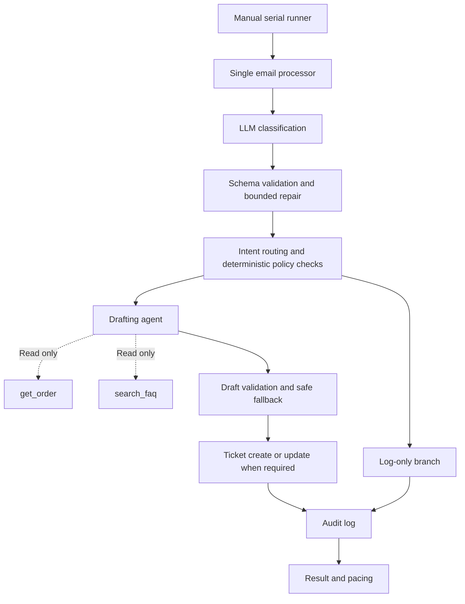

# Kesar AI Copilot

**AI-powered customer support automation | AI Engineer Intern assignment**

An n8n-based support copilot that classifies customer emails, retrieves authorized order and FAQ information, drafts grounded replies, creates or updates support tickets, and records an auditable decision trail in Google Sheets. The system is draft-only: it does not send emails, issue refunds, cancel orders, or execute pickups.

## 1. Project and evaluation links

| Resource | Link |
|---|---|
| Submission repository | [GitHub](https://github.com/jainnirdesh/kesar-ai-copilot) |
| Final consolidated 25-email evaluation (viewer) | TODO: insert verified Google Sheets link |
| V1 evaluation (viewer) | TODO: insert link |
| V2 evaluation (viewer) | TODO: insert link |
| V2.1 iteration and final batch evidence (viewer) | [Kesar Support V2.1](https://docs.google.com/spreadsheets/d/1HGxMWQL_vcvzvMeHUfSDpeL9Y0ypoWsIQbPMRuq7nFM/edit) — verify sharing before submission |
| Test report | [TEST_REPORT.md](TEST_REPORT.md) |
| Importable workflows | [workflow/](workflow/) |
| Demonstration recording | Not supplied; original submission requirement remains outstanding unless waived by the organizer. |

### Live n8n workflow directory

Replace `N8N_BASE_URL` with the actual instance URL and fill missing workflow IDs. Live editor links require authorized n8n access; the JSON exports are the portable reviewer deliverable. No account credentials are shared.

| Revision | Processor | Serial runner |
|---|---|---|
| V1 | TODO: live link | TODO: live link |
| V2 | TODO: live link | TODO: live link |
| V2.1 | `N8N_BASE_URL/workflow/K6FHRm1Pr0UrXOgK` | `N8N_BASE_URL/workflow/CEUsJ0dEb2lNrmr1` |
| V2.1 Currency (baseline) | `N8N_BASE_URL/workflow/yQEa4MiFAmm1zOi3` | `N8N_BASE_URL/workflow/TSOBXasEmk7SgmSL` |
| V2.1 Currency (extended) | `N8N_BASE_URL/workflow/ScFToWd0CKYCabUo` | `N8N_BASE_URL/workflow/vGPVHH0uw37vYcxK` |

## 2. Problem and scope

Kesar needs a reliable first-pass support assistant for order status, product questions, returns/refunds, complaints and miscellaneous messages. The objective is to reduce repetitive support work while keeping sensitive decisions and irreversible actions under human control. The assignment uses supplied fictional emails, orders and FAQ content, not a live customer database.

## 3. Architecture

The diagram is a logical overview, not an exact n8n node map. The agent chooses read-only tools; deterministic workflow code owns authorization, eligibility, ticket writes and audit persistence. The serial runner reduces concurrent ticket-write races and paces provider calls.

## 4. Technology and configuration

| Component | Implementation |
|---|---|
| Orchestration | n8n Cloud (final execution telemetry: 3.3.0) |
| LLM | Gemini 3.1 Flash Lite in earlier iterations; Gemini 3.5 Flash Lite in final batches |
| Business logic | JavaScript Code nodes |
| Storage | Google Sheets: audit and tickets |
| Knowledge | Supplied orders and FAQ; read-only tools |
| Temperature | 0 |
| Confidence threshold | 0.85 |
| Classification / drafting output limits | 1024 / 2048 tokens |
| Pacing | 15 seconds between emails |
| Model attempts | Bounded classification and draft repair; provider-internal retries not observable |

Final profile: `v2.1-currency-1`, model `models/gemini-3.5-flash-lite`. A shared runtime configuration controls the model and target profile. Earlier model changes were motivated by repeated provider 503 failures, so final-versus-earlier results are not a controlled same-model experiment.

## 5. Workflow behavior

| Intent | Processing |
|---|---|
| `order_status` | Authorized order lookup, status draft or clarification/escalation |
| `product_query` | FAQ-grounded product reply; medical questions escalated |
| `return_refund` | Order lookup, deterministic eligibility and fee checks, ticket and draft |
| `complaint` | Order lookup, high-priority ticket and grounded response |
| `other` | Audit-only handling, with human review where appropriate |

Secondary intents are considered so a complaint or refund obligation is not silently dropped. The classification schema includes intent, secondary intent, explicit order ID, sentiment, language, confidence and summary. Resolved order IDs are kept distinct from extracted IDs. Order lookup checks ownership before disclosure. Open tickets for the same order are reused within the configured ticket scope, with email IDs and notes appended.

## 6. Prompt and safety design

Classification prompts require structured output matching the supplied schema. Drafting prompts restrict claims to authorized order facts and FAQ policy, require appropriate language and brand voice, and forbid unsupported promises. Customer messages are untrusted input, not instructions to the system. The final currency revision explicitly guides the model to include currency markers for authorized monetary amounts (for example, INR 79) without weakening the monetary validator.

Deterministic checks cover privacy, policy dates based on email receipt time, monetary values, medical claims, unsafe commitments and draft formatting. Invalid outputs receive bounded repair or a safe contextual fallback. Low-confidence or risky cases are flagged for human review. Audit records include model/profile information, observed tool outcomes and validation history where available. Tool compliance is evaluated against applicable requirements, not by forcing irrelevant calls.

## 7. Setup and reproduction

1. Create an n8n instance and configure Gemini and Google Sheets credentials in n8n's credential manager. Do not put keys in workflow JSON or Git.
2. Create a spreadsheet with Audit Log and Tickets tabs using the supplied CSV header templates. Use isolated, header-only tabs for new evaluation runs.
3. Import the processor JSON first, then its matching runner JSON from `workflow/`. Select the imported processor in the runner's Execute Workflow node; enable waiting for completion and accept the runner input.
4. Bind the Google Sheets credentials to read/write nodes and Gemini credentials to both model nodes. Preserve dynamic model expressions and the configured output limits.
5. Set the spreadsheet ID, matching processor ID, exact tab names, run mode and actual n8n version in the runner configuration. Use the matching revision's supported modes; do not bypass profile guards.
6. Run a single smoke email in isolated smoke tabs and verify the audit row, ticket (if required), tool outcomes and draft. Then run the appropriate baseline or extended runner against empty target tabs.
7. Export results and CSV evidence. Reconcile email IDs, audit records and ticket references before reporting metrics. Keep raw evidence unchanged.

**Extended-run caution:** the archived extended execution wrote to the currency smoke tabs despite its intended extended profile. Inspect actual persistence destinations before reusing this export. Do not treat it as a verified fix or run it against production data.

## 8. Iteration and evaluation

V1 and V2 were evaluated on the same 12 official emails. Each earlier baseline included 11 newly persisted records and one smoke replay. The following figures are from the earlier evidence review; expected classifications were derived from the supplied policies, not an official answer key.

| Metric | V1 | V2 |
|---|---:|---:|
| Emails accounted for | 12/12 | 12/12 |
| Primary intent matches | 12/12 | 12/12 |
| Secondary intent exact matches | 11/12 | 12/12 |
| Required-tool compliance | 8/12 reported | 12/12 observed |
| Generic fallback | 8/12 | 0/12 |
| Required ticket coverage | 6/6 | 6/6 |
| Manually satisfactory replies | 4/12 | 9/12 |

V2 improved tool grounding and reply usefulness, but unsupported attachment/product-condition claims and policy omissions remained. V2.1 added targeted prompt/validation hardening and observability. Repeated Gemini 503 errors led to a model change. The currency revision then corrected monetary prompt guidance and centralized runtime configuration. A successful E03 smoke run preceded the final evaluation.

### Final 25-email evaluation

The final evidence consists of 12 baseline emails (runner execution 44) and 13 extended emails (runner execution 57), covering E01–E25 exactly once for scoring. It is not a single uninterrupted 25-email run.

| Metric | Result |
|---|---:|
| Unique official emails covered | 25/25 |
| Persisted results in execution JSON | 25/25 |
| Primary intent matches (policy-derived evaluation) | 25/25 (100%) |
| Secondary intent exact matches (policy-derived evaluation) | 24/25 (96%) |
| Reported applicable tool compliance | 25/25 |
| Reported audit errors | 0/25 |
| Draft-only actions | 11 |
| Ticket-and-draft actions | 10 |
| Log-only actions | 4 |
| Human-review flags | 16 |
| Distinct ticket IDs across scored records | 9 |
| Mean processing latency (excluding inter-email pacing) | 48.40 seconds |

Execution JSON supports the coverage, action counts, flags, ticket IDs, error counts and latency above. Intent accuracy and JSON–CSV reconciliation are from the saved Codex evaluation checkpoint and must be cross-checked against the final TEST_REPORT. Local validators are not proof that every reply is semantically perfect. E04 and E21 share a ticket within the baseline batch. The extra E03 smoke row in the extended CSV is excluded from scoring, not deleted from raw evidence.

## 9. Screenshots and evidence

- [Workflow canvas](screenshots/workflow.png)
- [Tickets](screenshots/tickets.png)
- [Audit log — all 25 scored emails](screenshots/audit_log.png)
- [Detailed test report](TEST_REPORT.md)

These paths are the required submission destinations; verify the files exist before publishing. A consolidated reviewer Sheet should show all 25 scored records and their corresponding tickets, clearly labelled as a derived view of the two batches rather than a new live run.

## 10. Security and privacy

Secrets belong only in n8n credentials. Before publishing, scan exports, source, evidence, screenshots and Git history for tokens, keys, authorization headers and sensitive information. Share only authorized fictional assignment data. Read-only agent tools cannot perform real customer operations; workflow writes are limited to audit and ticket records. Spreadsheet writes use RAW values to reduce formula-injection risk. No real email sending or payment operation is integrated.

## 11. Known limitations and unresolved failures

- Final evaluation used two batches and a different model from earlier versions; improvements cannot be attributed solely to prompt or code changes.
- Extended persistence targeted smoke tabs unexpectedly. Raw evidence is retained; the leftover E03 smoke record is excluded from scored results. The routing defect remains unresolved.
- Cross-batch ticket deduplication is not established because the batches use separate ticket scopes. Within-batch deduplication was demonstrated.
- Provider 503 errors and long latency occurred. Provider-internal retry counts and actual token usage are not available for all runs.
- Contextual fallbacks remain necessary; classification summaries and sentiment may still contain inaccuracies even when final drafts pass validators.
- Earlier preservation checks reported two failures involving pre-existing `.DS_Store` metadata; the currency revision's targeted tests passed. This is not an all-tests-pass claim.
- Live n8n editor access requires authorization; exported workflows are the reproducible deliverable. Recording is not supplied and is an outstanding original requirement unless explicitly waived.

## 12. Scaling and production strategy

For production, use an authenticated ingestion endpoint, durable queue, rate-limited workers, idempotency keys and a transactional ticket store with unique constraints. Replace spreadsheet writes with a database-backed audit trail and provide a human-review dashboard. Separate retryable provider errors from permanent validation failures; use bounded exponential backoff, dead-letter handling and alerting. Track model/version, token usage, latency, fallback rate and reviewer corrections. Apply access controls, retention rules and redaction to customer data. Start with draft-only shadow mode, then expand only after a measured safety review.

## 13. Product-thinking answers

### 1. When would you allow auto-send?

I would start with draft-only operation. After a representative shadow evaluation, consider auto-send only for low-risk order-status and FAQ replies with calibrated confidence of at least 0.95, successful authorized retrieval, no validation errors and no conflicting intent. Confidence alone is insufficient. Complaints, refunds, medical issues, identity mismatches and ambiguous cases always require human approval. Monitor sampled replies and provide an immediate kill switch.

### 2. What would this cost at scale?

The assignment used free-tier services; actual billed spend and complete token counts have not been independently verified. At 1,000 emails/day, a 30-day month contains 30,000 emails. Estimate monthly model cost as 30,000 multiplied by the average sum of input and output token charges across classification, agent rounds and repair calls. Add orchestration, storage, monitoring and human-review costs. Instrument actual token usage and use current provider prices before quoting a monetary forecast. Caching stable FAQ content and avoiding unnecessary model calls can reduce cost without weakening safety.

### 3. What would you measure in week one, and when would you stop?

My primary metric would be the percentage of drafts accepted by reviewers without substantive edits, measured on a representative sample. A proposed initial target is 90%, alongside complete audit coverage and zero critical privacy or unauthorized-action incidents. Pause automation immediately after any confirmed sensitive-data disclosure or unauthorized commitment, or if audit persistence becomes unreliable. Investigate, repair and rerun regression tests before resuming.

### 4. What should the customer experience when automation fails?

The system should not invent an answer or claim an action succeeded. Preserve the email, record the failure, flag it for human review and generate a safe acknowledgement only when supported by policy. Avoid exposing internal errors to the customer. Give the support team enough context to continue without asking the customer to repeat information unnecessarily. In this assignment the acknowledgement remains a draft, not an automatically sent email.

### 5. What should remain manual?

Refund authorization and execution, cancellations, replacement approvals, damage verification, medical or adverse-reaction cases, identity disputes and policy exceptions should remain under human control. The copilot can gather authorized facts, calculate policy eligibility, prepare drafts and prioritize tickets. Humans should retain responsibility for financial decisions, sensitive exceptions and ambiguous situations. This separation limits harm while preserving most of the efficiency gains.

## 14. AI assistance disclosure

ChatGPT and Codex were used to help interpret the assignment, design and implement workflows, develop prompts and validators, prepare tests, troubleshoot provider/configuration failures, analyze evidence and draft documentation. The candidate configured the external n8n and Google Sheets integrations, ran the evaluation batches and collected execution evidence. AI-generated claims and code require review; the limitations above are intentionally retained rather than presenting the system as flawless.
